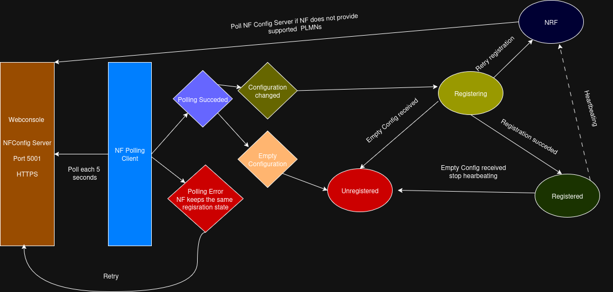

<!--
SPDX-FileCopyrightText: 2025 Canonical Ltd
SPDX-FileCopyrightText: 2021 Open Networking Foundation <info@opennetworking.org>
Copyright 2019 free5GC.org

SPDX-License-Identifier: Apache-2.0
-->
[](https://scorecard.dev/viewer/?uri=github.com/omec-project/nrf)
[](https://github.com/omec-project/nrf/releases)
[](https://spdx.org/licenses/Apache-2.0.html)

# NRF

Network Repository Function provides service discovery functionality in the 5G
core network. Each network function registers with NRF with a set of properties
called as NF Profile. Implements 3gpp specification 29.510. NRF Keeps the
profile data for each network function in the MongoDB. Supports Discovery and
registration procedure. When the discovery API is called, NRF fetches a matching
profile from the database and returns it to the caller.


## NRF flow diagram


## Supported Features
- Registration of Network Functions
- Searching of matching Network functions
- Handling multiple instances of registration from Network Functions
- Supporting keepalive functionality to check the health of network functions


## Upcoming changes in NRF
- Supporting callbacks to send notification when a network function is added/removed/modified.
- Subscription management callbacks to network functions.
- NRF cache library which can be used by modules to avoid frequent queries to NRF

Compliance of the 5G Network functions can be found at [5G Compliance](https://docs.sd-core.aetherproject.org/overview/3gpp-compliance-5g.html)

## Dynamic Network configuration (via webconsole)

NRF fetches the latest PLMN configuration from Webconsole whenever a network function registers without providing
a list of supported PLMNs.
If a network function does not provide a list of supported PLMNs and NRF is not able to fetch any PLMN from Webconsole (or
Webconsole is unreachable), registration fails.
If a network function provides a list of supported PLMNs, it is registered without NRF fetching the configuration from Webconsole.

### Setting Up PLMN configuration fetch

Include the `webuiUri` of the Webconsole in the configuration file
```
configuration:
  ...
  webuiUri: https://webui:5001 # or http://webui:5001
  ...
```
The scheme (http:// or https://) must be explicitly specified.

## Access token signing key

The NRF signs OAuth2 access tokens (`/oauth2/token`) with a private key in PEM format
(PKCS#8, PKCS#1 RSA or SEC1 EC): RSA of at least 2048 bits, ECDSA P-256/P-384/P-521, or Ed25519.
Provision a deployment-specific key (for example as a mounted secret) and reference it in the configuration file
```
configuration:
  ...
  accessTokenKey: /path/to/nrf-token.key
  ...
```
If `accessTokenKey` is not set, `sbi.tls.key` is used. If no key can be loaded, the NRF still starts and serves
discovery and management, but access token requests fail with HTTP 500 (fail-closed). A configured `accessTokenKey`
that cannot be loaded aborts startup. Producers verify tokens with the matching public key or certificate; the
`kid` header is the base64url SHA-256 of the PKIX-encoded public key.

## Reach out to us through

1. #sdcore-dev channel in [ONF Community Slack](https://aether5g-project.slack.com/)
2. Raise Github issues
